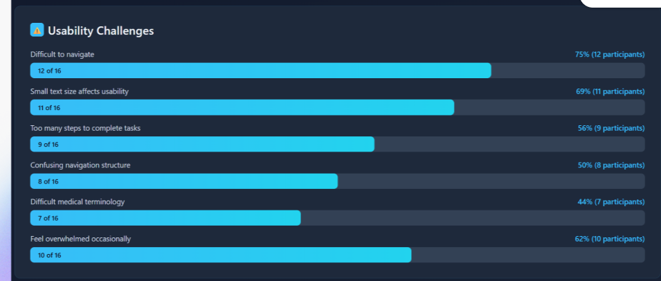
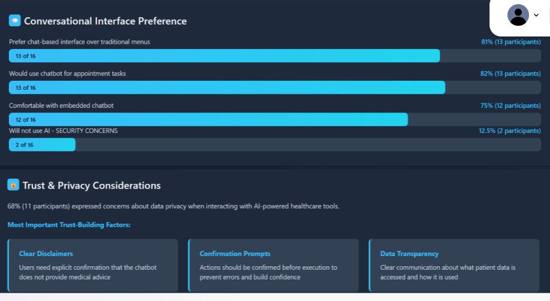
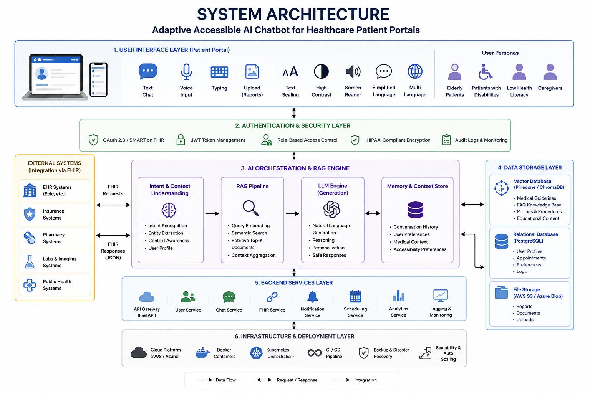
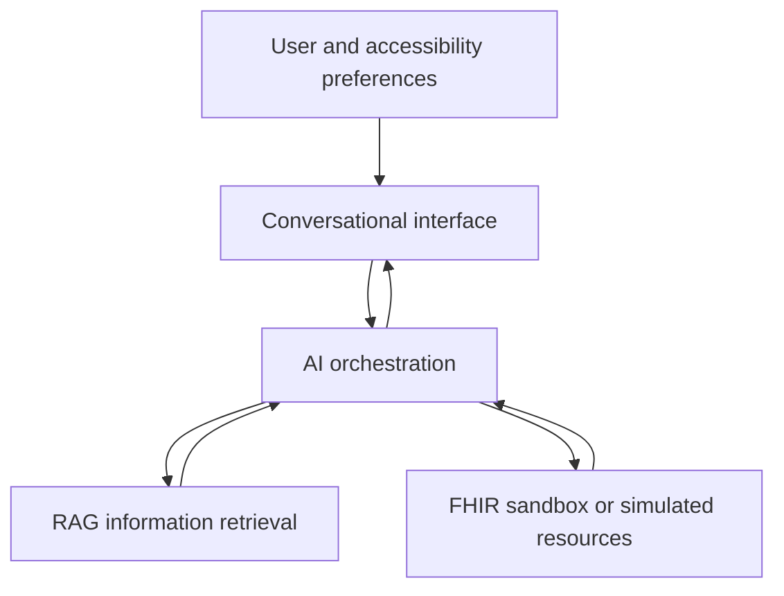

# Adaptive Healthcare Chatbot for Patient Portals

**Accessible AI · Human-centered design · Retrieval-Augmented Generation · FHIR**

A University of Connecticut master's capstone exploring an adaptive conversational assistant to make patient-portal navigation more accessible. The project combines a limited-scope prototype with a proposed architecture for conversational guidance, healthcare information retrieval and interoperability.

**Project author:** Hiral Choksi  
**Academic context:** Master's capstone in Computer Science and Engineering, University of Connecticut  
**Instructor:** Tingting Yu · **Report date:** May 2026

## The problem

Patient portals can require users to navigate complex menus and unfamiliar terminology while managing time-sensitive or stressful healthcare tasks. This project explores a simpler conversational interface for finding information and navigating common workflows, with accessibility preferences controlled by the user.

## Design highlights

- **User-selected accessibility modes:** vision support with larger text and high contrast; cognitive support with shorter responses and step-by-step prompts; plain-language explanations.
- **Conversational navigation:** scenarios include finding appointments, accessing information and navigating portal tasks.
- **User control:** confirmation prompts are part of the design before actions, and accessibility adaptation uses explicit user-selected preferences.
- **Human-centered research:** the presentation describes patient-portal survey and interview work and personas to explore navigation friction and accessibility needs.

## Survey findings

The report presents survey graphics for **16 participants**. The figures report that **12 of 16** found navigation difficult, **11 of 16** reported that small text affected usability, and **13 of 16** preferred a chat-based interface. These are small-sample, self-reported design insights, not evidence of clinical effectiveness.

*Original survey visualizations from the project report; percentages in the source are rounded and one displayed percentage is inconsistent with its count.*

## Proposed system architecture

*Original architecture diagram from the report. It represents the broader proposed design, including future capabilities and security goals; it is not evidence of production deployment or verified compliance.*

The report proposes React and Tailwind CSS for the interface, FastAPI for backend services, and a retrieval layer using embeddings and vector search. SMART on FHIR and OAuth are described as part of the intended authorization and interoperability design. **This diagram describes the proposed architecture; it does not establish that every component was implemented or integrated.**

## Outcomes and project scope

The capstone materials document an accessibility-focused design, proposed architecture, user research and a **minimum viable product with a limited set of workflows**. The report describes use of sandbox or simulated FHIR environments and limited-scale usability evaluation; it does not provide a quantitative performance benchmark or enough detail to reproduce a complete evaluation.

**Future work:** broader accessibility testing, voice and multilingual support, additional workflows and integration with live healthcare environments.

## Project report

[Read the capstone report](docs/capstone-report.pdf). The original report includes proposed architecture and forward-looking claims; the scope and limitations below clarify what can be established from the available materials.

## Status and limitations

- This repository is a **project showcase**; source code, datasets and a runnable application are not currently included.
- Live Epic MyChart integration is identified as future work. The materials do not establish production deployment or independently verified HIPAA compliance.
- The assistant is intended for supportive navigation and is not a substitute for professional medical advice or clinical decision-making.
- No patient data or interview transcripts are included in this repository.

## Skills demonstrated

Human-centered AI · Conversational interface design · Accessibility · RAG architecture · FHIR interoperability · React · FastAPI · Healthcare workflows · User research · System design
